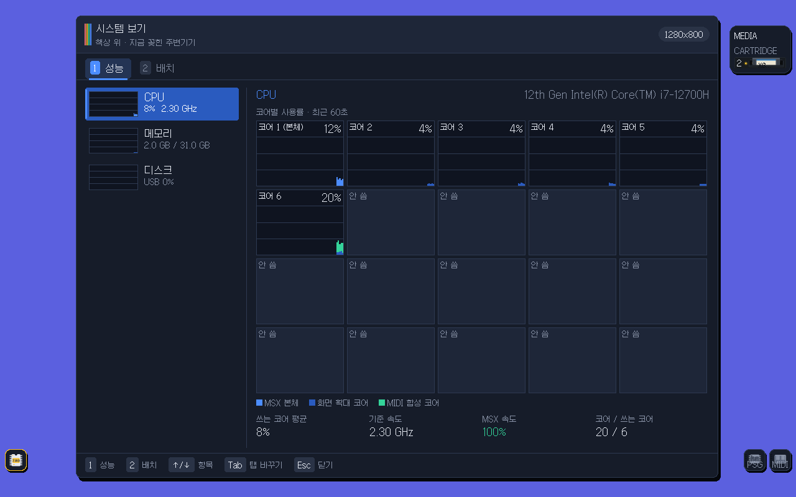
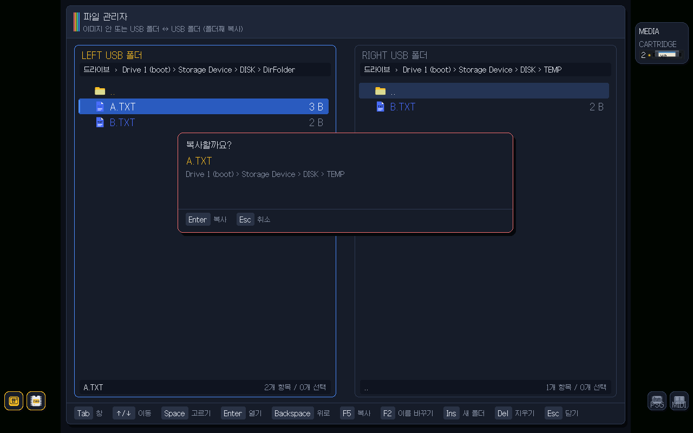
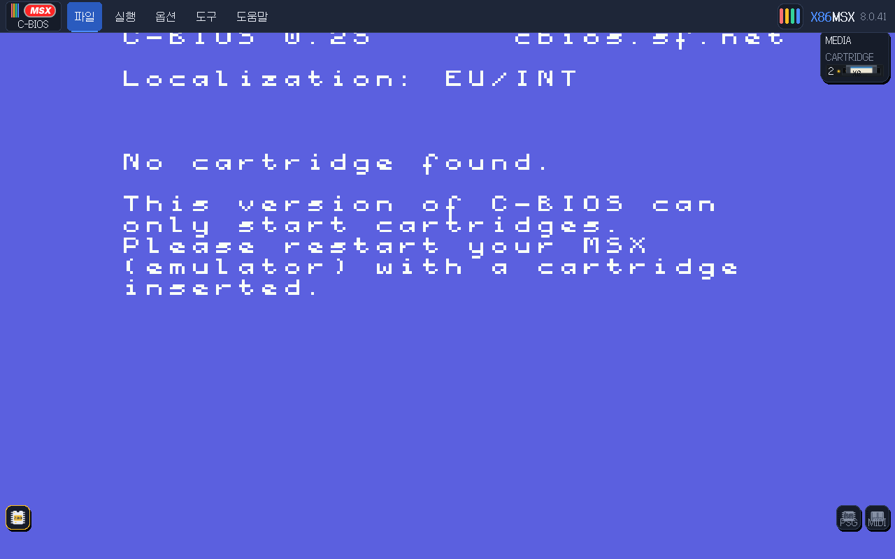
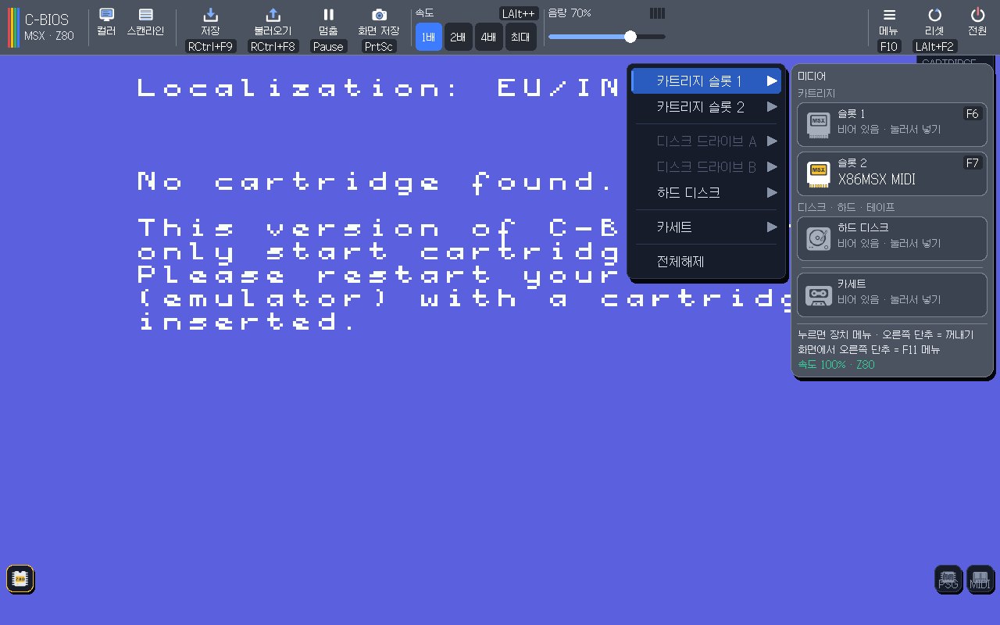
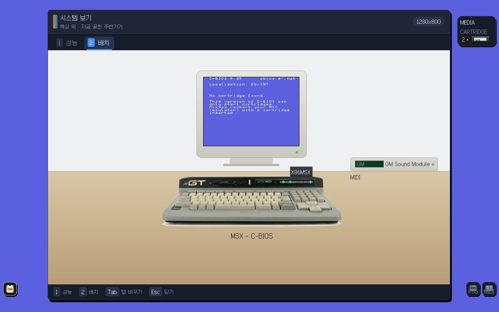
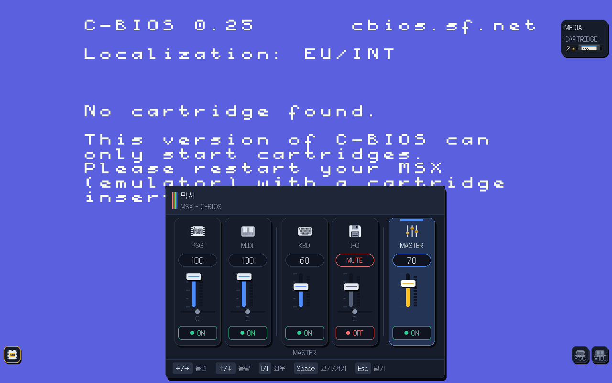
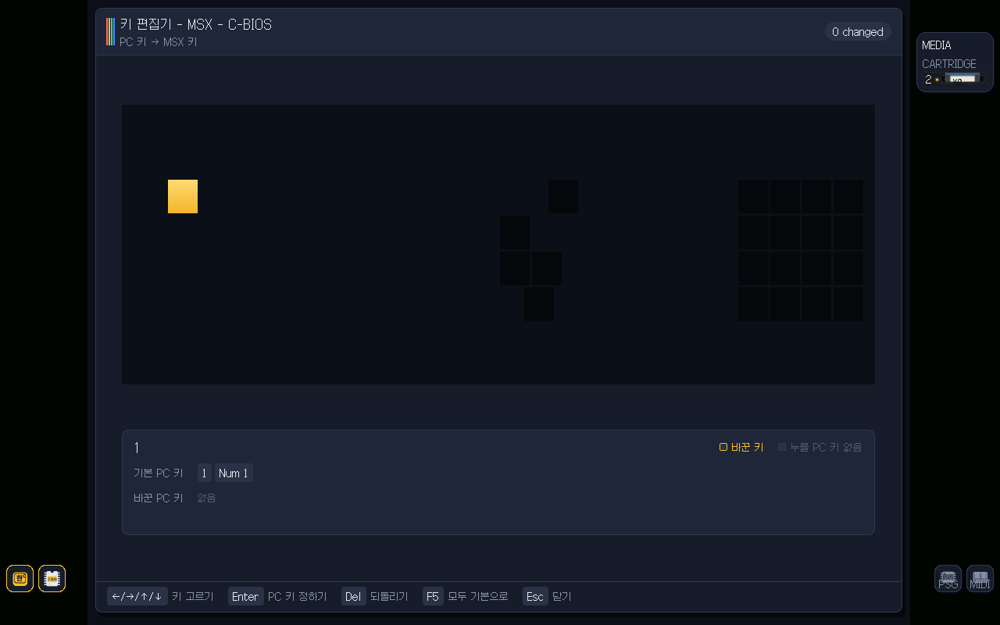
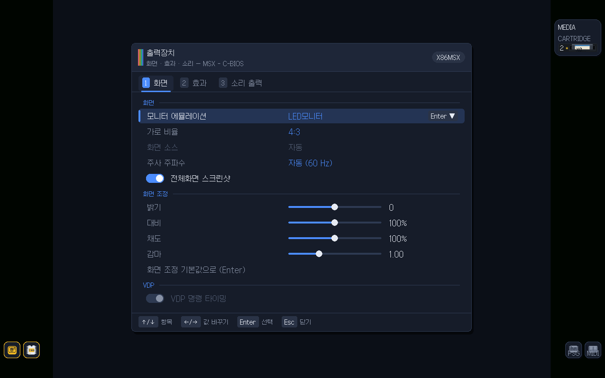
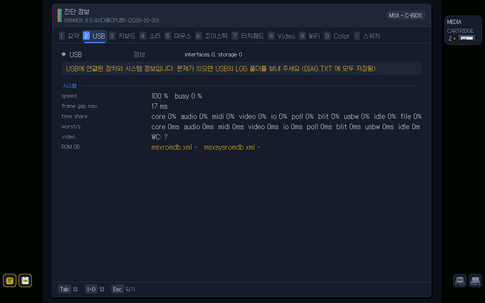
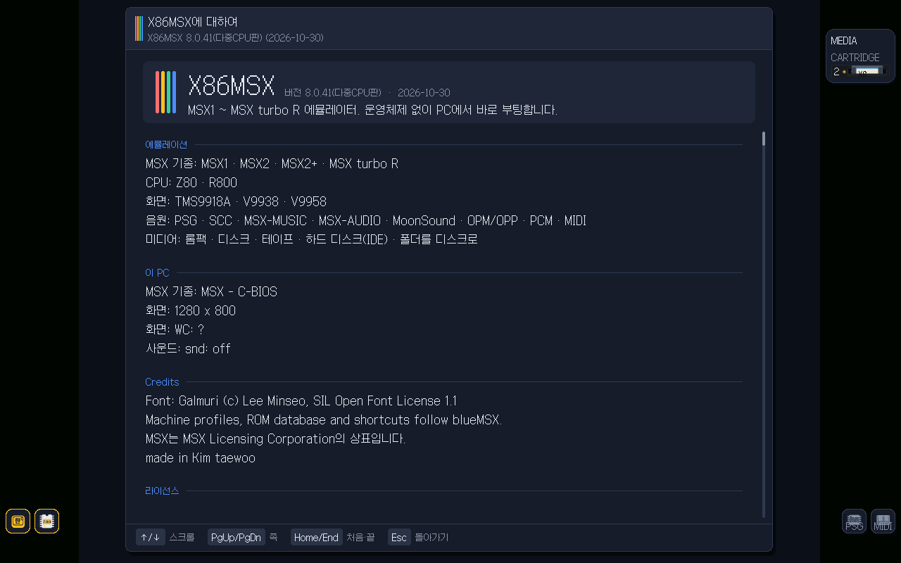

<!-- 만든이: KimTaeWoo / 도와준이: Lee.J.H -->
<h1 align="center">X86MSX</h1>

<p align="center"><b>운영체제 없이 PC에서 바로 부팅하는 MSX 에뮬레이터 — MSX1 · MSX2 · MSX2+ · turbo R · V9990</b></p>

<p align="center">
  
  
  
</p>

<p align="center"><a href="README_EN.md">English</a></p>

<p align="center"> 성능: 코어별 사용률"></p>

USB 메모리에 넣고 부팅하면 윈도우도 리눅스도 거치지 않고 MSX 화면이 바로 뜹니다.
같은 에뮬이라면 꼭 운영체제 위나 FPGA에서만 돌려야 할까? 하는 물음에서 시작했습니다.
8.0판부터는 PC의 여러 코어를 나눠 써서 화면 확대와 MIDI 합성을 다른 코어에 맡깁니다.

## 왜 만들었나

작년부터 의문이 있었습니다.

조금 지난 1 ~ 현재 세대 컴퓨터에서 운영체제 없이 MSX 시스템을 에뮬할 수 있을까?
왜 에뮬레이터는 운영체제 위에서, 아니면 FPGA에서만 만들 생각을 할까?
어차피 같은 에뮬인데.

그래서 작년부터 어셈블러와 C로 코딩할 생각을 했습니다.
이미 잘 만들어진 칩들의 소스와 BIOS를 모으기 시작했고,
어셈블러로 첫 화면까지 열심히 코딩했습니다. 짬짬이 하는 일이라 옵션도 기능도 없이
BASIC 첫 화면만 봤습니다.

뭐, 80년대 프로그래머가 하는 짓이 그렇지 하면서 왜 만들게 되었는지 적어 둡니다.
Ai와 협동으로 만들었습니다.

## 안에 들어 있는 것

- **기종:** MSX1 / MSX2 / MSX2+ / turbo R (Z80, R800). blueMSX의 `config.ini`와 Machines 폴더 구조를 그대로 읽어 기종을 고릅니다. 처음에는 자유 BIOS인 C-BIOS 기종으로 뜹니다.
- **영상:** V9938 / V9958 / V9990, 화면 확대, 주사선 효과, 화면 비율 조절, 스크린샷과 영상 녹화.
- **소리:** PSG, FM(OPLL), MSX-Audio, SCC(두 개), MoonSound(OPL4), MIDI(MT-32 / CM-32L, SC-55, SoundFont)를 장치별로 따로 다루고, PC의 HD Audio로 내보냅니다.
- **저장 장치:** 디스크 이미지, zip 안의 디스크, Nextor 하드디스크, USB 폴더를 하드디스크처럼 보이게 하는 **가상 하드(VMFolder)**.
- **카트리지:** 일반 ROM, ASCII8/16, Konami, SCC 등 여러 매퍼와 특수 카트리지. ROM 데이터베이스로 자동 판별합니다.
- **네트워크:** 유선(DHCP)·무선 LAN, UNAPI 네트워크 카트리지.
- **입력:** 키보드 중심 메뉴, 키 편집기, 조이스틱·마우스.
- **다중 코어(8.0):** 일꾼 코어 풀이 화면 확대 줄 그리기와 MIDI 합성을 나눠 맡습니다. 쉴 때는 CPU를 재우는 절전(AMD MONITORX/MWAITX 등)으로 팬 소리를 줄입니다.
- **도구:** 시스템 보기(코어·메모리·디스크 사용률, 배치), 파일 관리자(이미지 안 ↔ USB 폴더 복사), 이미지 만들기, USB 전체 용량 사용, 진단정보(USB·키보드·소리).
- **상태 저장·다국어:** 상태 저장과 이어하기, 한국어·영어·일본어 외 여러 언어.

<p align="center"></p>

## 화면 구경

<table>
<tr>
<td align="center"><br><sub>메뉴 막대와 도구 모음</sub></td>
<td align="center"><br><sub>카트리지·디스크·카세트 슬롯</sub></td>
</tr>
<tr>
<td align="center"> 배치"><br><sub>시스템 보기 > 배치</sub></td>
<td align="center"><br><sub>믹서</sub></td>
</tr>
<tr>
<td align="center"><br><sub>키 편집기 (키보드 그림)</sub></td>
<td align="center"><br><sub>출력장치(화면) 설정</sub></td>
</tr>
<tr>
<td align="center"><br><sub>진단정보</sub></td>
<td align="center"><br><sub>X86MSX에 대하여</sub></td>
</tr>
</table>

## 필요한 것

| 구분 | 내용 |
|---|---|
| 필수 | UEFI 부팅이 되는 x86-64 PC, USB 메모리 |
| 필수 | MSX BIOS ROM (없으면 C-BIOS로 시작) |
| 선택 | 게임 ROM·디스크 이미지, MT-32 / SC-55 ROM, 사운드폰트 |
| 선택 | 유선·무선 LAN |

## 설치

1. 배포 폴더의 `X86MSX_v8.0.N.img_….zip`을 풀어 나온 `.img`를 USB에 씁니다. (또는 `X86MSX_v8.0.N_USB_….zip`의 내용을 FAT32 USB에 폴더째 복사)
2. 이미 쓰던 USB는 `EFI/BOOT/BOOTX64.EFI`와 `X86MSX.BIN` **두 파일을 모두** 새 판으로 바꿉니다. 한쪽만 바꾸면 판이 어긋납니다.
3. PC를 USB로 부팅합니다. 진단정보(DIAG)의 `efi=`와 `ver=`가 같은 판 번호인지 확인합니다.
4. 게임·ROM·디스크는 USB의 `Storage Device` 폴더 아래에 넣습니다.

> 상용 BIOS ROM과 게임은 이 저장소에 없습니다. 기본으로 들어 있는 것은 C-BIOS뿐이며, MT-32·SC-55 ROM은 사용자가 `MidiSound\MT32`, `MidiSound\SC55`에 넣어야 합니다.

### 가상 하드에 파일 넣기

USB의 `VMFolder`에 파일을 복사했으면 **하드 리셋(LAlt+F2)** 을 하세요. 가상 하드는 하드 리셋 때 폴더를 다시 읽습니다. 소프트 리셋은 다시 읽지 않습니다.

## 주요 단축키

| 키 | 동작 |
|---|---|
| RCtrl+RShift+V | 시스템 보기 (`1` 성능, `2` 배치) |
| 도움말 메뉴 > 파일 관리자 | 파일 관리자 (F5 복사, F2 이름 바꾸기, Ins 새 폴더, Del 지우기) |
| LAlt+F2 | 하드 리셋 |
| Esc | 창 닫기 |

## 만들고 시험하기

```sh
make test                     # 단위·장치 시험
make regress                  # 기종 부팅 회귀 시험 (ROM 필요)
make build/BOOTX64.EFI build/kernel.bin build/msx1.img
```

## 시험 상태

Z80 코어는 ZEXALL/ZEXDOC를 통과합니다. 고칠 때마다 단위·회귀 시험과 화면 해시 비교를 돌리고, 4세대부터 최신 세대까지 여러 대의 실제 노트북·데스크톱(AMD·Intel)에서 직접 부팅해 확인합니다. 실제 PC에서 잘 되던 동작은 바꾸지 않는 것을 원칙으로 합니다.

## 저장소 구성

```
boot/       부팅 로더
uefi/       UEFI 부팅 코드
kernel/     화면·메뉴·시스템 보기·파일 관리자 등 본체
src/        Z80/R800, VDP, 소리 칩, 카트리지, 디스크, 네트워크 장치
host/       PC 위에서 돌려 보는 시험용 호스트
machines/   기본 기종(C-BIOS) ***  Bluemsx의 머신방식으로 사용하였습니다.
assets/     아이콘·키보드 그림·네트워크 ROM 등
third_party/  포함한 외부 구성요소
tools/      이미지 만들기 등 빌드 도구
tests/      자동 시험
docs/       문서 그림
```

## 8.0판에서 달라진 것

- 화면 확대와 MIDI 합성을 다른 코어에서 처리하고, 성능 탭에서 코어별 사용률(코어 1 = 본체, 코어 2~)을 봅니다.
- 쉬는 동안 CPU를 재우는 절전, 진단 스위치 탭(진단 기록 켜고 끄기).
- 시스템 보기·파일 관리자·이미지 만들기·USB 전체 용량 사용·진단정보로 도움말 메뉴 정리.
- 파일 관리자 복사 전 "복사할까요?" / "덮어쓸까요?" 확인.
- 부팅 이미지의 설정(INI) 기본값을 필요한 항목만 골라 정리.

## 라이선스

X86MSX 자체 코드는 GNU GPL v3 이상입니다 (`LICENSE`).
emu2413·emu8950(MIT), tinf(zlib), lwIP(BSD-3), Galmuri 글꼴(OFL), Munt mt32emu(LGPL), Nuked-SC55(GPL), TimGM6mb(GPL), C-BIOS(BSD) 등을 포함하며, 목록은 `THIRD-PARTY-NOTICES.txt`에 있습니다.
Nextor는 자체 조건(자유 배포, 판매 금지)을 따르며 GPL 대상이 아닙니다. MSX 및 관련 상표는 각 권리자의 것입니다.

## 고마운 분들

- **만든이:** KimTaeWoo · **도와준이:** Lee.J.H
- **BIOS·데이터:** C-BIOS 팀, blueMSX·openMSX (ROM 데이터베이스, 키보드 지도)
- **소리:** emu2413·emu8950, Munt(MT-32), nukeykt(Nuked-SC55), TimGM6mb
- **구성요소:** lwIP, tinf, Galmuri 글꼴(Lee Minseo), Nextor
- 코드 작성과 시험에 Claude(Anthropic)의 도움을 받았습니다.

MSX를 아직 사랑하는 모든 분께.
