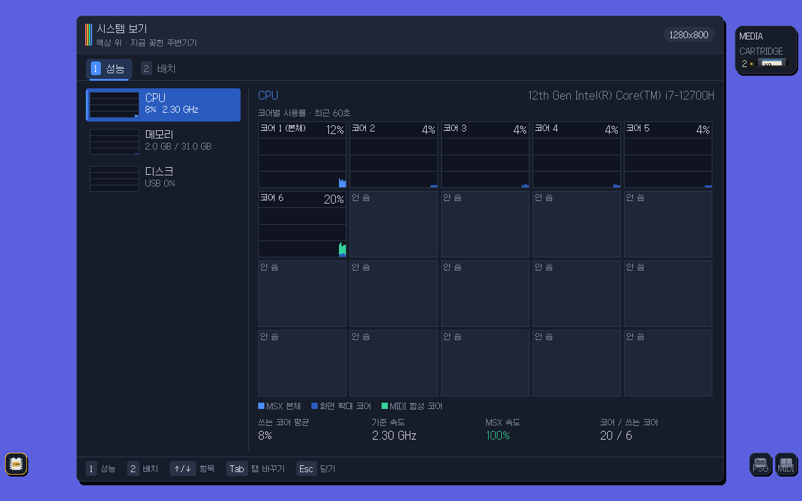
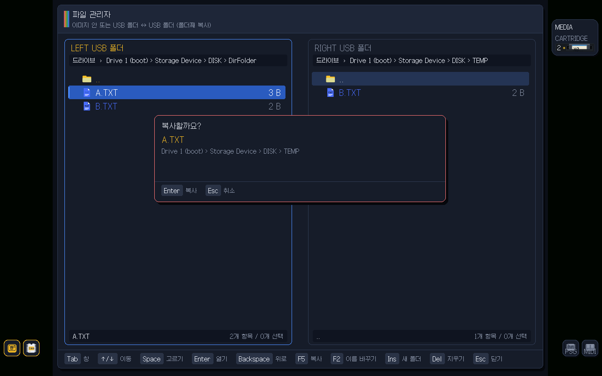
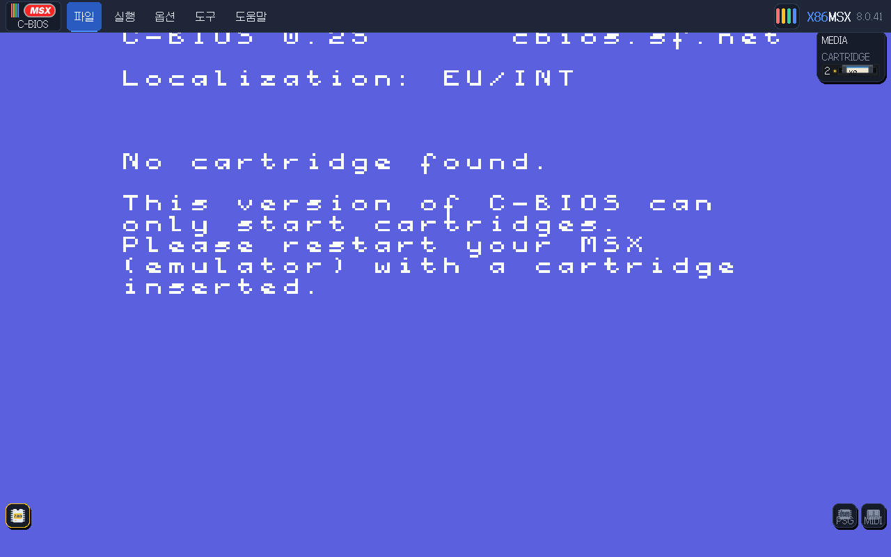
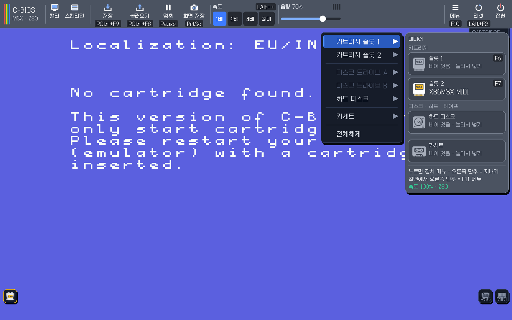
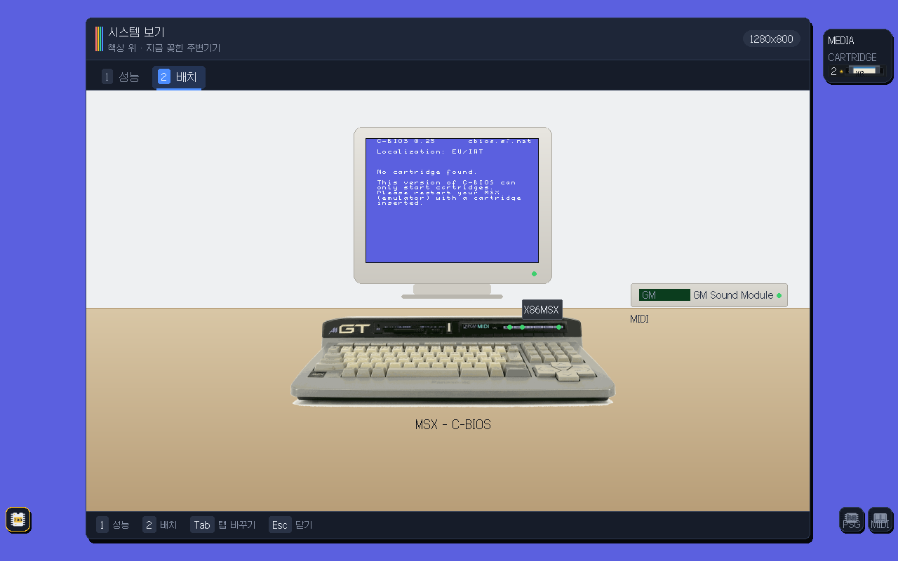
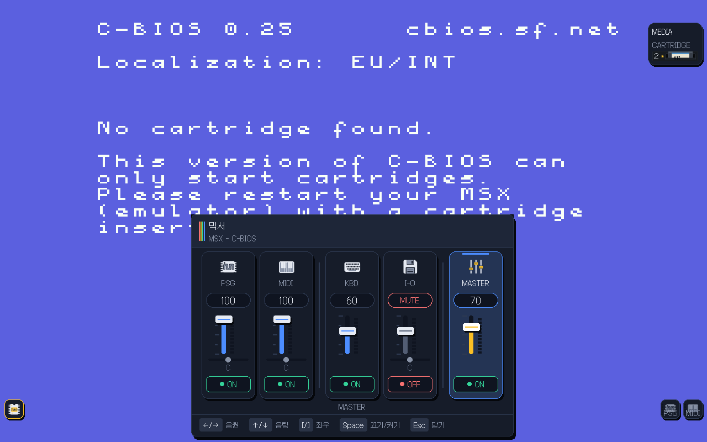
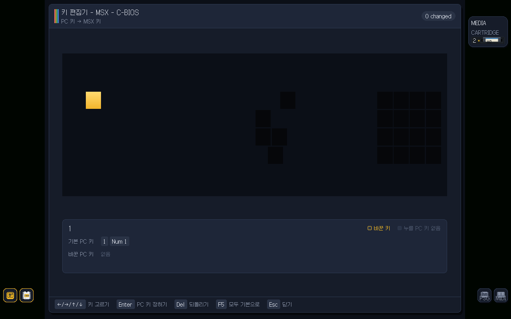
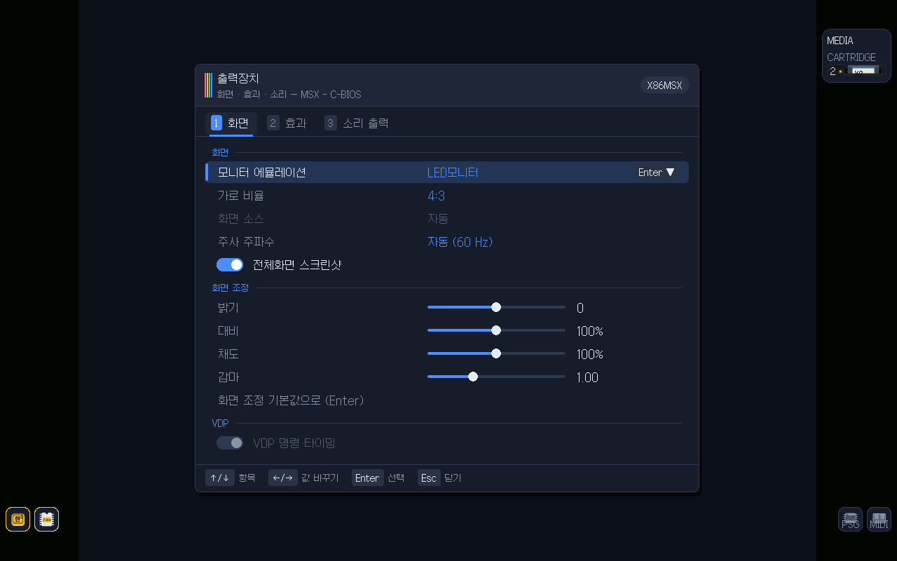
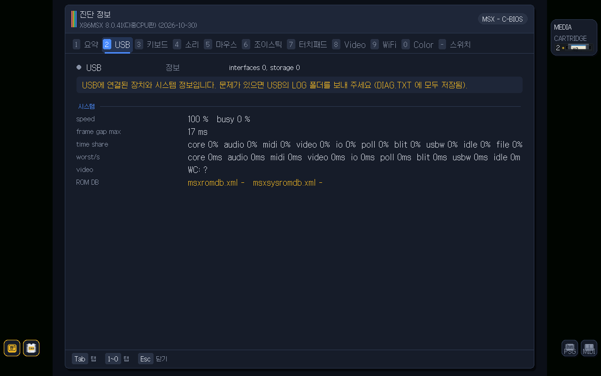
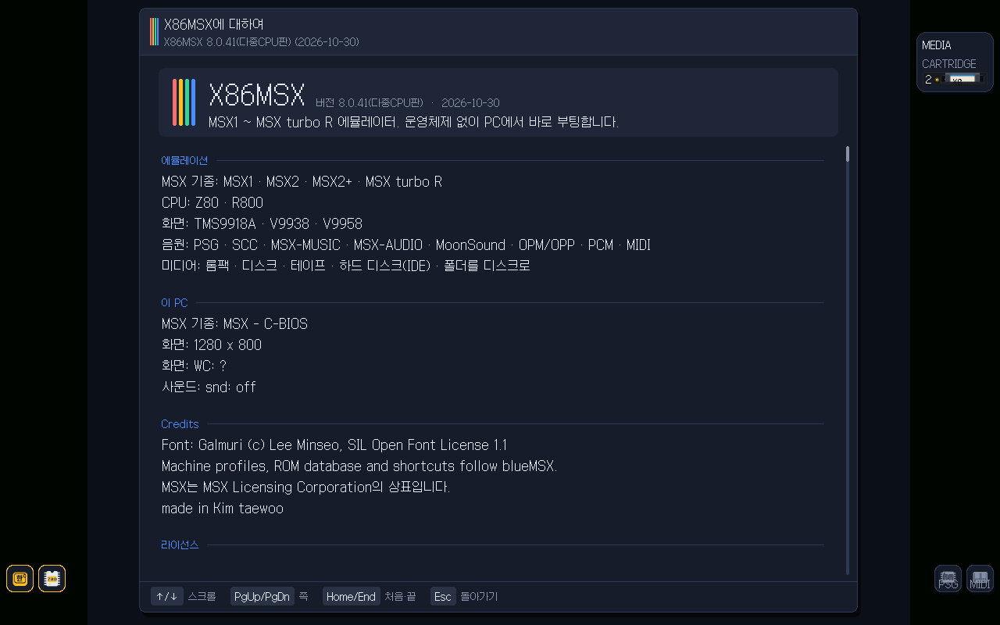

<h1 align="center">X86MSX</h1>

<p align="center"><b>An MSX emulator that boots straight from USB on a PC — no operating system. MSX1 · MSX2 · MSX2+ · turbo R · V9990</b></p>

<p align="center">
  
  
  
</p>

<p align="center"><a href="README.md">한국어</a></p>

<p align="center"> Performance: per-core load"></p>

Put it on a USB stick, boot the PC in UEFI mode, and the MSX screen appears — no Windows, no Linux.
Starting with 8.0 it spreads work over several CPU cores: screen scaling and MIDI synthesis run on other cores.

## What's inside

- **Machines:** MSX1 / MSX2 / MSX2+ / turbo R (Z80, R800). Reads blueMSX `config.ini` and the Machines folder layout. Starts with the free C-BIOS machine. The machine editor draws and edits the slot layout, expanded slots included.
- **Video:** V9938 / V9958 / V9990, a cartridge-style V9968 (second VDP), scaling, scanlines, aspect control, screenshots and video recording.
- **Audio:** PSG, FM (OPLL), MSX-Audio, SCC (two), MoonSound (OPL4, stereo), MIDI (MT-32 / CM-32L, SC-55, SoundFont), each handled as its own device, output through PC HD Audio.
- **X86 Multimedia cartridge:** plays video (MV, MP4) and music (MP3, WAV, FLAC) from inside MSX, reading files from the boot USB or a directly opened USB stick. A USB stick is never mapped as a DOS drive on its own; players access it only while they use it.
- **Storage:** disk images, disks and ROMs inside archives (zip, ARJ, PMA, LZH), Nextor hard disks, and a **virtual hard disk (VMFolder)** that presents a USB folder as an MSX drive. Selection windows can also pick other USB sticks.
- **Cartridges:** plain ROM, ASCII8/16, Konami, SCC, multi-game (30in1) and other mappers, special cartridges, ROM-database detection.
- **Network:** separate wired (X86Ethernet) and wireless (x86wifi) cartridges; DHCP, UNAPI, wireless network selection.
- **Input:** keyboard-driven menus, key editor, joystick and mouse.
- **Multi-core (8.0):** a worker pool takes screen-scaling lines and MIDI synthesis; idle sleeping (AMD MONITORX/MWAITX etc.) lowers fan noise.
- **Tools:** System view (per-core / memory / disk load, layout), file manager (image ↔ USB folder copy), image maker, use-whole-USB, diagnostics (USB, keyboard, sound) with switches.
- **Save states, multiple languages:** global and per-machine state saving are independent; Korean, English, Japanese and more.

<p align="center"></p>

## Screenshots

<table>
<tr>
<td align="center"><br><sub>Menu bar and toolbar</sub></td>
<td align="center"><br><sub>Cartridge / disk / cassette slots</sub></td>
</tr>
<tr>
<td align="center"> Layout"><br><sub>System view > Layout</sub></td>
<td align="center"><br><sub>Mixer</sub></td>
</tr>
<tr>
<td align="center"><br><sub>Key editor (keyboard picture)</sub></td>
<td align="center"><br><sub>Output (video) settings</sub></td>
</tr>
<tr>
<td align="center"><br><sub>Diagnostics</sub></td>
<td align="center"><br><sub>About</sub></td>
</tr>
</table>

## Requirements

| | |
|---|---|
| Required | An x86-64 PC that boots UEFI, and a USB stick |
| Required | MSX BIOS ROMs (C-BIOS is used if none) |
| Optional | Game ROMs / disk images, MT-32 / SC-55 ROMs, a SoundFont |
| Optional | Wired or wireless LAN |

## Installation

1. Unzip `X86MSX_v8.0.N.img_….zip` and write the `.img` to a USB stick (or copy the contents of `X86MSX_v8.0.N_USB_….zip` onto a FAT32 stick, folders and all).
2. When updating an existing stick, replace `EFI/BOOT/BOOTX64.EFI`. If the new version adds folders or files (icons, ROMs…), unzip the accompanying `USB extra files` archive over the stick.
3. Boot from the USB stick; check the version number in the diagnostics.
4. Put games, ROMs and disks under `Storage Device` on the stick.

> Commercial BIOS ROMs and games are not included; only C-BIOS ships. MT-32 / SC-55 ROMs go in `MidiSound\MT32` and `MidiSound\SC55`.

**Virtual hard disk:** after copying files into `VMFolder`, do a **hard reset (LAlt+F2)**; the folder is rescanned on hard reset, not on soft reset.

## Key shortcuts

| Key | Action |
|---|---|
| RCtrl+RShift+V | System view (`1` Performance, `2` Layout) |
| Help menu > File manager | File manager (F5 copy, F2 rename, Ins new folder, Del delete) |
| LAlt+F2 | Hard reset |
| Esc | Close window |

## Build and test

```sh
make test
make regress                  # boot regression on real machines (ROMs required)
make build/BOOTX64.EFI         # UEFI executable
make image                    # build/msx1.img (bootable USB image)
```

## Status

The Z80 core passes ZEXALL/ZEXDOC. Every change runs unit tests, boot regression and screen-hash comparison, and is checked on several real laptops and desktops (AMD and Intel, 4th generation to current). Behaviour that already works on real PCs is not changed.

## Repository layout

```
uefi/         UEFI entry and drivers (video, sound, USB, network)
kernel/       UI, menus, system view, file manager
src/          Z80/R800, VDP, sound chips, cartridges, disks, network
host/         host-side test harness
machines/     default machine (C-BIOS)
assets/       icons, keyboard pictures, network ROM
third_party/  bundled components
tools/        build tools, X86VHD (Windows virtual-HD copy tool), X86NTP (MSX-DOS clock sync)
tests/ docs/
```

## License

X86MSX's own code is GNU GPL v3 or later (`LICENSE`). Bundled components (emu2413, emu8950, tinf, lwIP, Galmuri fonts, Munt, Nuked-SC55, TimGM6mb, C-BIOS …) are listed in `THIRD-PARTY-NOTICES.txt`. Nextor has its own terms (free distribution, no sale). MSX and related marks belong to their owners.

## Thanks

- **Author:** KimTaeWoo · **Helper:** Lee.J.H
- C-BIOS team; blueMSX and openMSX (databases, keyboard maps)
- emu2413 / emu8950, Munt, nukeykt (Nuked-SC55), TimGM6mb, lwIP, tinf, Galmuri (Lee Minseo), Nextor
- Code written and tested with help from Claude (Anthropic).

For everyone who still loves MSX.
